# B-Trust Microbanking System

A full-stack micro-banking system for branch staff: customer onboarding, savings accounts, joint accounts,
fixed deposits, deposits and withdrawals, automated interest, and management reports, with separate
**Admin**, **Manager** and **Agent** roles.

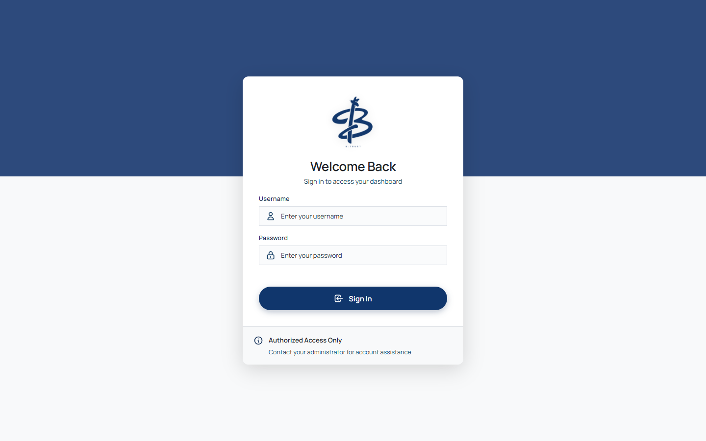

## Contents

- [Features](#features)
- [Tech stack and architecture](#tech-stack-and-architecture)
- [Getting started](#getting-started)
- [Demo data and logins](#demo-data-and-logins)
- [Testing and code quality](#testing-and-code-quality)
- [CI/CD](#cicd)
- [Database design (ERD)](#database-design-erd)
- [Screenshots](#screenshots)
- [Project structure](#project-structure)
- [Security](#security)
- [Troubleshooting](#troubleshooting)

## Features

| Role | What they can do |
|------|------------------|
| **Admin** | Create, edit, activate/deactivate staff · create, edit and delete branches · monitor savings and FD interest · management reports with date ranges, print and CSV export |
| **Manager** | View and filter all customer accounts in their branch · monitor agent performance and each agent's transactions · branch transaction summary |
| **Agent** | Register and edit customers · open savings accounts (incl. joint) · upgrade saving plans · close accounts · deposits and withdrawals · open and close fixed deposits · personal performance dashboard |
| **Everyone** | Secure login, change own password, responsive layout on phone, tablet and desktop |

**CRUD coverage**

| | Create | Read (list / search / filter / sort) | Update | Delete |
|---|---|---|---|---|
| Staff | Add user wizard | Searchable table | Edit user, change status, change password | Deactivate (soft delete) |
| Branches | Add branch | Searchable table | Edit branch | Delete (blocked while in use) |
| Customers | Registration wizard | NIC lookup, manager search | Edit contact details | — (kept for audit) |
| Accounts | Account wizard | Search by ID/NIC, status filter, sortable columns | Change saving plan | Close account |
| Fixed deposits | FD wizard | Search by ID/NIC | Auto-renewal at maturity | Deactivate FD |
| Transactions | Deposit / withdrawal | History, date-range reports | — (immutable ledger) | — (immutable ledger) |

**Business rules:** NIC validation, age-based saving plans (Children, Teen 12+, Adult 18+, Senior 60+, Joint),
minimum balances, interest credited every 30 days, FD maturity by plan, staff must be 18+, and audit trails for
transactions, plan changes and customer edits. Rules that protect money are enforced **in the database**
(see [Database design](docs/database/README.md)), and every form is validated on both the client and the server.

## Tech stack and architecture

| Layer | Technology |
|-------|------------|
| Frontend | React 19, TypeScript, React Router 7, Axios, Recharts, Vite 8, Vitest, ESLint |
| Backend | Node.js, Express 4, express-validator, JWT, bcrypt, helmet, express-rate-limit, node-cron, node:test + supertest |
| Database | PostgreSQL 14+ (constraints, triggers, PL/pgSQL functions, views) |

```
 Browser (React SPA)                     Express API                          PostgreSQL
┌─────────────────────┐   HTTPS/JSON   ┌──────────────────────────┐   pg    ┌──────────────────────┐
│ Role dashboards     │ ─────────────▶ │ helmet · CORS · rate lim │ ──────▶ │ tables + constraints │
│ Client validation   │   JWT bearer   │ JWT auth → role check    │         │ triggers (balance,   │
│ Toasts / dialogs    │ ◀───────────── │ express-validator        │ ◀────── │ audit, min age, FD)  │
│ Lazy-loaded views   │                │ controllers → services   │         │ PL/pgSQL functions   │
└─────────────────────┘                │ node-cron interest jobs  │         │ reporting views      │
                                       └──────────────────────────┘         └──────────────────────┘
```

Each request passes through security middleware, JWT verification, a role check and input validation before a
controller hands it to a service, which runs parameterised SQL. Money movements go through database functions
inside a transaction, so a rule violation rolls everything back. The full endpoint list is in
[docs/API.md](docs/API.md).

### Design decisions

| Decision | Where | Why |
|----------|-------|-----|
| **Layered backend**: routes → validators → controllers → services → database | `backend/src/` | Each layer has one job (single responsibility). Controllers only translate HTTP; business rules live in services, so they can be tested and reused without Express |
| **One error path**: services throw `AppError` (`badRequest`, `notFound`, …); one middleware turns it, or any PostgreSQL error, into a JSON response | [`errorHandler.js`](backend/src/middleware/errorHandler.js), [`pgErrors.js`](backend/src/errors/pgErrors.js) | Removes ~48 repeated `try/catch` blocks; error responses are consistent everywhere |
| **`withTransaction()` helper** for BEGIN/COMMIT/ROLLBACK | [`db/index.js`](backend/src/db/index.js) | A thrown error always rolls back and releases the connection, so no handler can leak a client |
| **Centralised config** read from environment variables | [`config/env.js`](backend/src/config/env.js) | One place for defaults; the interest schedule and the admin screens share the same values |
| **Strategy objects** for FD vs savings interest | [`interest.service.js`](backend/src/services/interest.service.js) | One batch runner (with per-credit savepoints) handles both; a new interest type only adds a strategy (open/closed) |
| **Feature folders** in the frontend, mirroring backend domains | `frontend/src/features/` | Code for a feature (screen, modal, helpers) lives together and is easy to find |
| **API layer**: components never build URLs or import axios | [`frontend/src/api/`](frontend/src/api/index.ts) | Swapping or mocking the backend touches one folder (dependency inversion) |
| **Shared building blocks** | `utils/format.ts`, `utils/validation.ts`, `hooks/usePersistentState.ts`, `features/auth/session.ts` | Replaced 20 copies of currency/date/age helpers and 6 copies of saved-tab logic (DRY) |

## Getting started

### Quick start with Docker

Needs only [Docker Desktop](https://www.docker.com/products/docker-desktop/).

```bash
cp .env.example .env      # set JWT_SECRET
docker compose up --build
```

Open http://localhost:8080 and log in as `admin` / `admin123`. The database is created on first start and kept in
a Docker volume (`docker compose down -v` removes it). nginx serves the frontend and forwards `/api` to the backend.

### Local development

**Prerequisites:** Node.js 20.19+ (or 22.12+), npm, PostgreSQL 14+ with `psql` on your PATH.

#### 1. Database

From the project root:

```bash
psql -U postgres -f database/setup.sql
```

This creates the `microbanking` database, the schema, the saving/FD plans, a main branch and the admin user.
To start again: `psql -U postgres -c "DROP DATABASE microbanking;"` and run setup again.

#### 2. Backend (http://localhost:5000)

```bash
cd backend
cp .env.example .env      # set PGPASSWORD and JWT_SECRET
npm install
npm run dev
```

If your PostgreSQL password contains `#`, wrap it in single quotes in `.env`: `PGPASSWORD='my#pass'`.

#### 3. Frontend (http://localhost:3000)

```bash
cd frontend
cp .env.example .env      # VITE_API_BASE_URL=http://localhost:5000
npm install
npm run dev
```

### Environment variables (backend)

| Variable | Default | Purpose |
|----------|---------|---------|
| `PGHOST` `PGPORT` `PGDATABASE` `PGUSER` `PGPASSWORD` | localhost, 5432, microbanking, postgres | Database connection |
| `PGSSL` | `false` | `true` for hosted databases such as Railway |
| `JWT_SECRET` | — (required) | Secret used to sign login tokens |
| `PORT` | `5000` | API port |
| `CORS_ORIGIN` | `http://localhost:3000` | Comma-separated frontend URLs allowed to call the API |
| `LOGIN_RATE_LIMIT` | `10` | Failed logins allowed per IP per 15 minutes |
| `FD_INTEREST_CRON` / `SAVINGS_INTEREST_CRON` | `0 3 * * *` / `30 3 * * *` | When interest jobs run |
| `INTEREST_CYCLE` | `30 days` | Time between interest credits for each account |
| `INTEREST_CRON_DEBUG` | `0` | `1` runs jobs every 10 s with a 1-minute cycle, for demos |

## Demo data and logins

| Username | Password | Role |
|----------|----------|------|
| `admin` | `admin123` | Admin |

For a realistic demo, start the backend and run:

```bash
cd backend
npm run seed:demo
```

This uses the real API (so every rule applies) to create 2 branches, a manager (`manager1`), two agents
(`agent1`, `agent2`), 10 customers, 9 accounts on every plan including a joint account, transactions and
2 fixed deposits. Staff password: `Demo1234`. It is safe to run more than once.

Change the admin password after the first login (sidebar → **Change Password**).

## Testing and code quality

| Command | Where | What it checks |
|---------|-------|----------------|
| `npm test` | backend | 22 HTTP tests: routing, security headers, auth, role checks, validation |
| `TEST_PGDATABASE=microbanking_test npm test` | backend | + 14-step integration test against a real database (branch → staff → customer → account → transactions → interest → closure) |
| `npm run lint` | backend, frontend | ESLint (no warnings allowed) |
| `npm run typecheck` | frontend | TypeScript strict mode |
| `npm run test:run` | frontend | Vitest: validation rules, notifications, app render |
| `npm run build` | frontend | Type check + production build with per-page code splitting |

Create the integration test database once with
`psql -U postgres -v dbname=microbanking_test -f database/setup.sql`. The integration suite refuses to run
against a database whose name does not contain `test`.

## CI/CD

GitHub Actions ([`.github/workflows/ci-cd.yml`](.github/workflows/ci-cd.yml)) runs on every push and pull request:

| Job | Steps |
|-----|-------|
| **Backend** | `npm ci` → ESLint → HTTP tests + integration tests against a PostgreSQL 16 service container built from `database/setup.sql` |
| **Frontend** | `npm ci` → ESLint → TypeScript check → Vitest → production build |
| **Docker images** | Builds the `backend` and `frontend` images. On `main` they are **published to GitHub Container Registry** as `ghcr.io/<owner>/<repo>-backend` and `-frontend`, tagged `latest` and with the commit SHA |
| **Smoke test** | Starts the whole stack with `docker compose`, then checks the app loads, client-side routes work, the API answers through nginx and the admin can log in |

Images are only published after the backend and frontend jobs pass. Any server with Docker can deploy a release with
`docker compose pull && docker compose up -d` (point `image:` at the GHCR images). Dependabot
([`.github/dependabot.yml`](.github/dependabot.yml)) opens monthly pull requests for npm and Actions updates, and
CI tests each one.

## Database design (ERD)

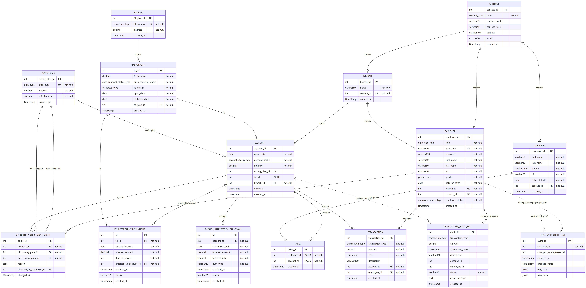

15 tables in third normal form, 9 named CHECK constraints, 8 triggers, 16 functions/procedures, 5 views and
50 indexes. The ERD is also available as an [SVG](docs/database/erd.svg), as [Mermaid source](docs/database/erd.mmd)
and as [DBML for dbdiagram.io](docs/database/schema.dbml). Details and the data dictionary:
[docs/database/README.md](docs/database/README.md).

## Screenshots

| | |
|---|---|
| 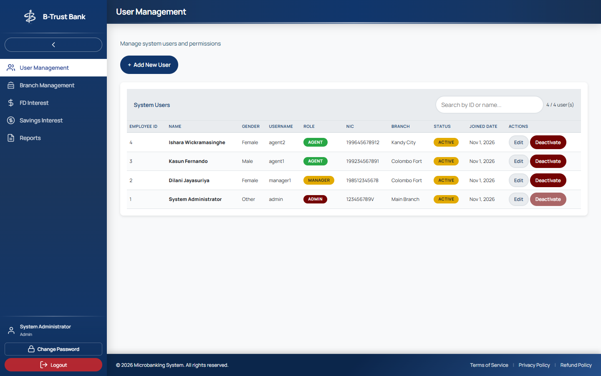 Admin: user management | 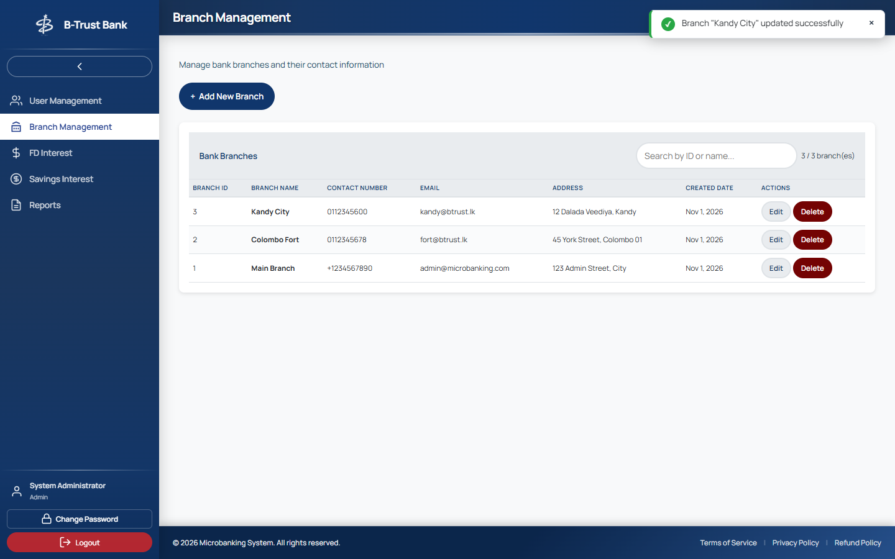 Admin: branch edited (toast) |
| 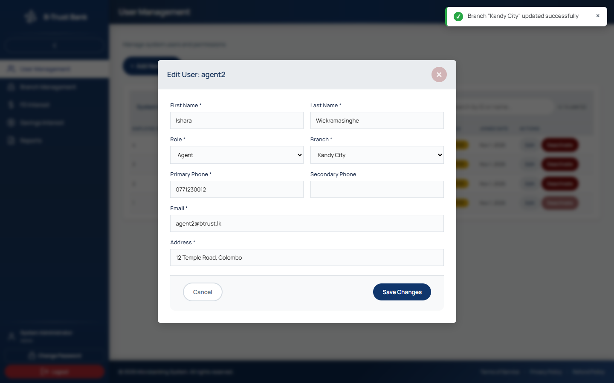 Admin: edit user | 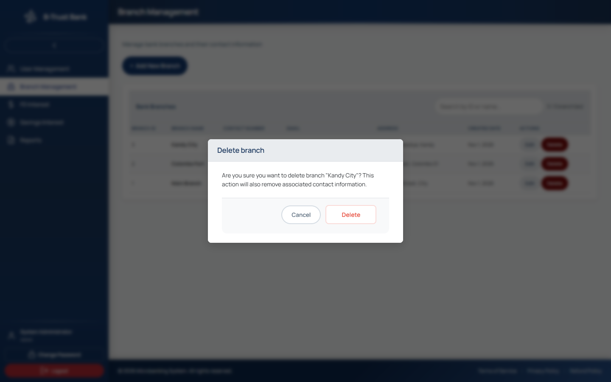 Confirmation before deleting |
| 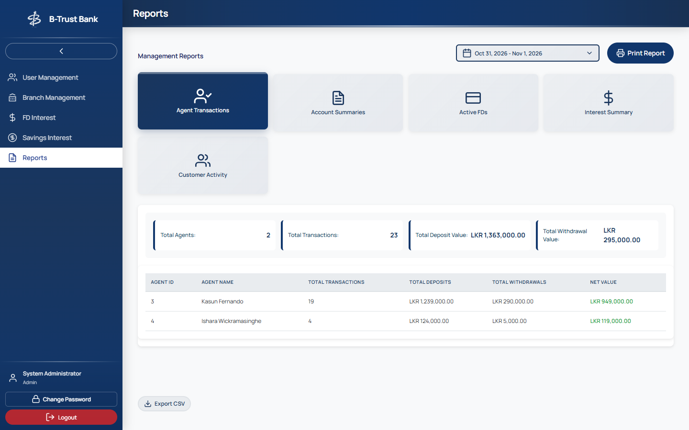 Admin: reports | 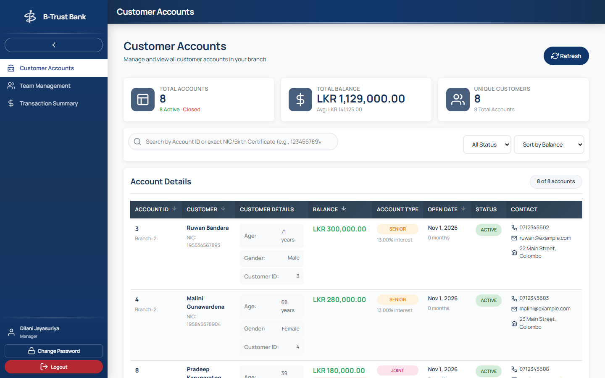 Manager: customer accounts |
| 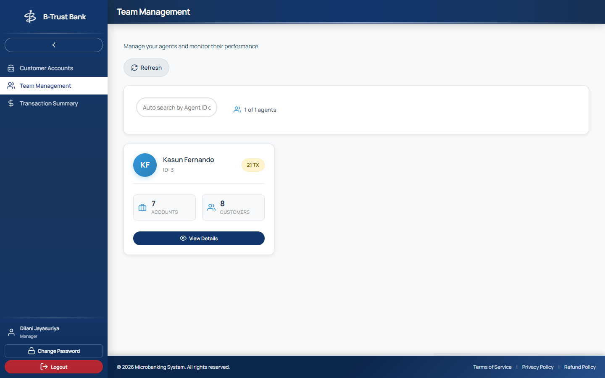 Manager: team performance | 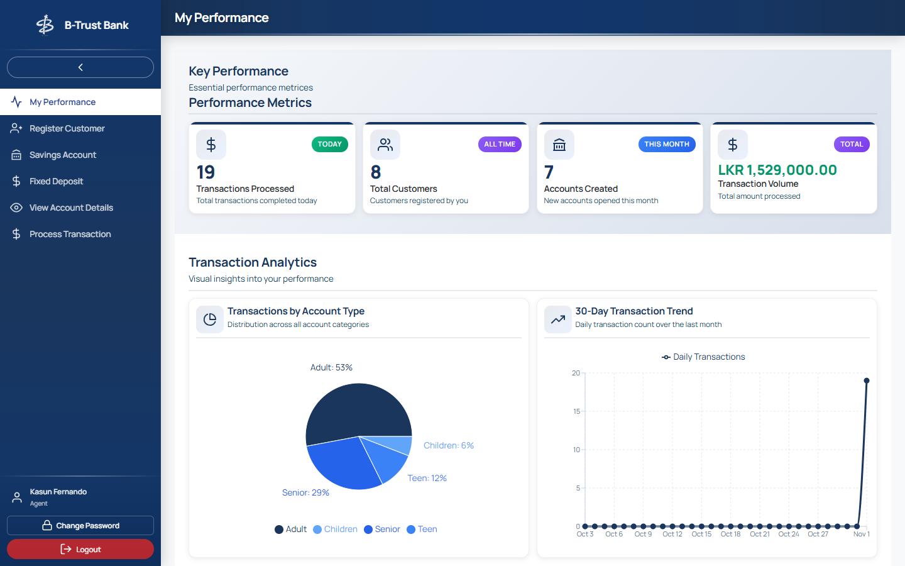 Agent: performance dashboard |
| 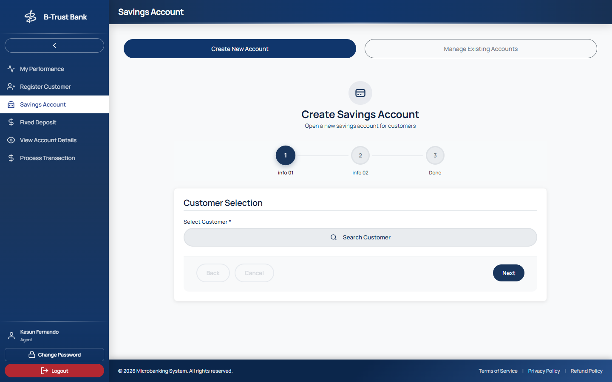 Agent: open savings account | 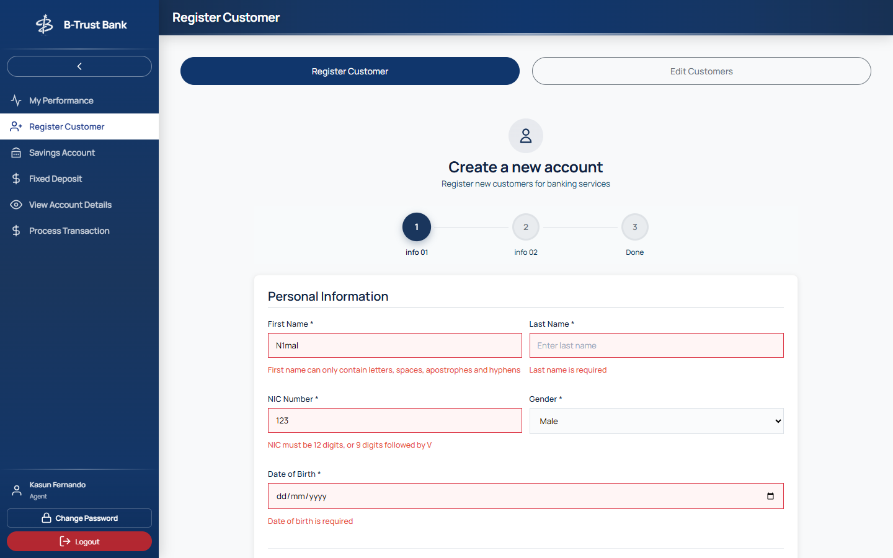 Inline validation errors |

| Mobile | | |
|---|---|---|
| 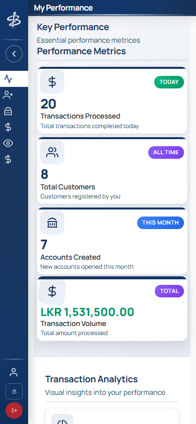 | 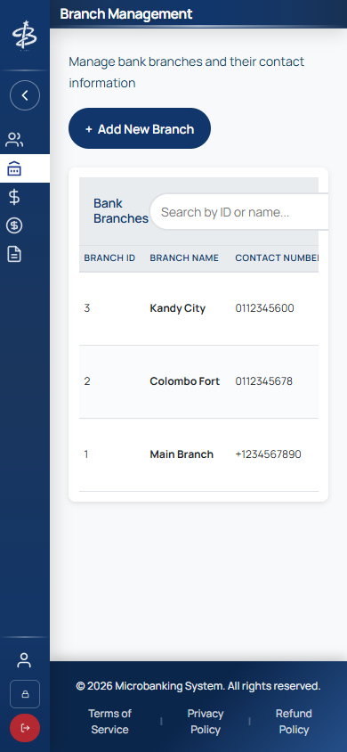 | Sidebar collapses to icons; wide tables scroll inside their card |

## Project structure

```
microbanking/
├── backend/
│   ├── src/
│   │   ├── server.js            Start-up: config check, DB connection, interest schedulers, graceful shutdown
│   │   ├── app.js               Express app: security middleware, /api routes, error handling
│   │   ├── config/env.js        All environment settings and their defaults
│   │   ├── db/                  Connection pool, query and withTransaction helpers
│   │   ├── routes/              URL → validation → controller, one file per role
│   │   ├── validators/          express-validator rules (shared field rules in common.js)
│   │   ├── controllers/         HTTP in/out only, one file per domain
│   │   ├── services/            Business rules and SQL, one file per domain
│   │   ├── middleware/          JWT auth + role check, rate limiting, error handler
│   │   ├── errors/              AppError and PostgreSQL error mapping
│   │   ├── jobs/                node-cron interest schedulers
│   │   └── utils/               asyncHandler, response helpers
│   ├── scripts/                 Demo data seeder, password hash helper
│   └── tests/                   node:test + supertest suites
├── frontend/
│   └── src/
│       ├── main.tsx             Entry point
│       ├── app/                 Router and app shell (+ render test)
│       ├── api/                 HTTP client and one API object per backend domain
│       ├── features/            auth, dashboard, customers, accounts, transactions, fixed-deposits,
│       │                        employees, branches, reports, interest
│       ├── components/          Shared UI: toasts, confirm dialog, error boundary, footer
│       ├── hooks/               usePersistentState
│       ├── utils/               Validation rules, formatting, notification bus (+ tests)
│       └── styles/              Global styles
├── database/                    setup.sql, schema, seed data
├── docker/initdb.sh             Creates the database when the Postgres container first starts
├── docker-compose.yml           Database + API + nginx frontend in one command
├── .github/                     CI/CD workflow and Dependabot configuration
└── docs/                        API reference, Postman collection, database design + ERD, screenshots, report
```

## Security

- Passwords hashed with bcrypt; JWTs expire after 1 hour and an expired session returns the user to the login page.
- Role-based access on every protected route (`authorize('Admin')`, etc.).
- All SQL is parameterised; inputs are validated by express-validator and again by database constraints.
- `helmet` security headers, CORS restricted to the configured frontend, 100 kB body limit.
- Failed logins are rate-limited; internal errors are logged, never sent to the browser.
- `.env` files are git-ignored; only `.env.example` templates are committed.

## Troubleshooting

| Problem | Fix |
|---------|-----|
| `password authentication failed` | Check `PGPASSWORD` in `backend/.env` (quote it if it contains `#`) |
| `database "microbanking" already exists` | Drop it first, or keep the existing one |
| `function calculate_fd_interest_due(interval) does not exist` | Your database was created by an older version: drop it and run `setup.sql` again |
| `JWT_SECRET is not set` | Copy `backend/.env.example` to `.env` and set `JWT_SECRET` |
| Login works but every page says "Cannot reach the server" | Backend not running, or `VITE_API_BASE_URL` / `CORS_ORIGIN` mismatch |
| Port 3000 or 5000 already in use | Stop the other process or change `PORT` / the Vite port |
