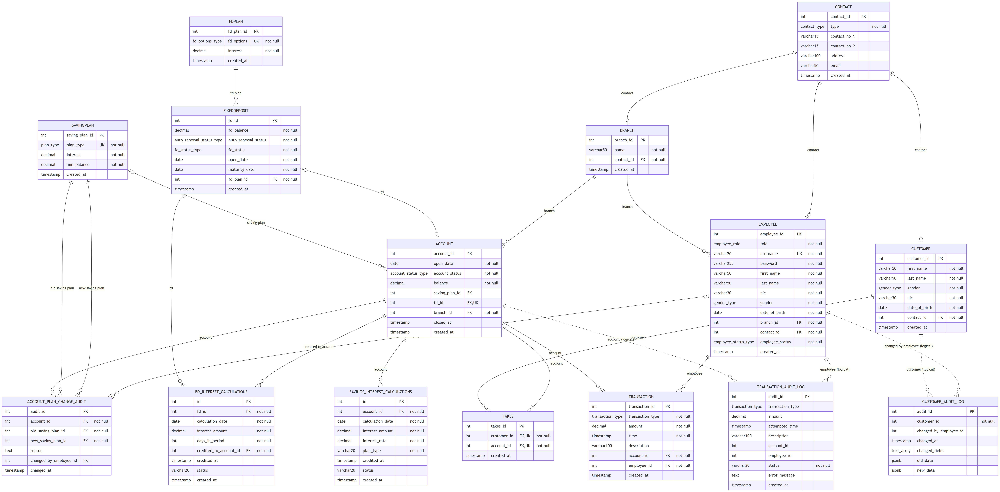

# Database Design

PostgreSQL 14+ database for the B-Trust Microbanking System. Business rules that protect money live in the
database itself (constraints, triggers and functions), so they hold no matter which client writes the data.

| File | Purpose |
|------|---------|
| [`../../database/setup.sql`](../../database/setup.sql) | Creates the database and runs the three scripts below |
| [`../../database/init-postgres.sql`](../../database/init-postgres.sql) | Schema: types, tables, constraints, functions, triggers, views, indexes |
| [`../../database/insert-interests.sql`](../../database/insert-interests.sql) | Seed data: saving plans and FD plans |
| [`../../database/insert-admin.sql`](../../database/insert-admin.sql) | Default branch and admin user |
| [`erd.mmd`](erd.mmd) / [`erd.png`](erd.png) / [`erd.svg`](erd.svg) | Entity-relationship diagram (Mermaid source and rendered images) |
| [`schema.dbml`](schema.dbml) | Same schema for [dbdiagram.io](https://dbdiagram.io) (paste it in to view or edit) |

## Entity-Relationship Diagram

Solid lines are foreign keys enforced by the database. Dashed lines are logical links in the audit tables,
which deliberately have no foreign key so audit rows survive even if the referenced row changes.
The diagram was generated from the live database catalog, so it matches the schema exactly.

## Entities

| Entity | Description | Key relationships |
|--------|-------------|-------------------|
| `contact` | Phone numbers, address and email, shared by branches, customers and employees (`type` says which) | 1 : 0..1 with each owner |
| `branch` | A bank branch | has many employees and accounts |
| `employee` | Staff login with role `Admin`, `Manager` or `Agent` and status `Active`/`Inactive` | belongs to one branch |
| `customer` | Account holder identified by NIC / birth-certificate number | owns accounts through `takes` |
| `takes` | Associative entity resolving the **many-to-many** customer ↔ account relationship (joint accounts) | unique (customer_id, account_id) |
| `account` | Savings account with balance, plan, branch and optional linked FD | one saving plan, one branch, 0..1 FD |
| `savingplan` | Children / Teen / Adult / Senior / Joint plans with interest rate and minimum balance | used by many accounts |
| `fixeddeposit` | Fixed deposit with principal, status, open and maturity dates | one FD plan, linked to one account |
| `fdplan` | 6-month, 1-year and 3-year FD plans with interest rate | used by many FDs |
| `transaction` | Every deposit, withdrawal and interest credit | one account, one employee |
| `fd_interest_calculations`, `savings_interest_calculations` | One row per interest credit (or failed attempt) | FD / account |
| `account_plan_change_audit` | History of saving-plan changes with reason and employee | account, plans, employee |
| `customer_audit_log`, `transaction_audit_log` | Change and transaction audit trails (JSONB before/after data) | logical links only |

## Data dictionary (core tables)

| Table.column | Type | Rules |
|--------------|------|-------|
| `contact.contact_no_1/2` | varchar(15) | CHECK `^[+]?[0-9]{9,14}$` |
| `contact.email` | varchar(50) | CHECK basic email format |
| `branch.name` | varchar(50) | NOT NULL, unique (case-insensitive index) |
| `employee.username` | varchar(20) | NOT NULL, UNIQUE |
| `employee.password` | varchar(255) | bcrypt hash (never plain text) |
| `employee.nic` / `customer.nic` | varchar(30) | CHECK 12 digits or 9 digits + `V`; UNIQUE |
| `employee.role` | enum `employee_role` | Admin, Manager, Agent |
| `employee.date_of_birth` | date | trigger: employee must be 18+ |
| `account.balance` | decimal(15,2) | NOT NULL, CHECK `>= 0`, only changed through the transaction trigger |
| `account.fd_id` | integer | FK → fixeddeposit, UNIQUE (one FD per account) |
| `savingplan.plan_type` | enum `plan_type` | UNIQUE |
| `savingplan.interest` | decimal(5,2) | CHECK 0–100 |
| `savingplan.min_balance` | decimal(10,2) | CHECK `>= 0` |
| `fixeddeposit.fd_balance` | decimal(15,2) | CHECK `> 0` |
| `fixeddeposit.maturity_date` | date | set by trigger from the plan; CHECK `> open_date` |
| `transaction.amount` | decimal(12,2) | CHECK `> 0` |
| `transaction.transaction_type` | enum | Deposit, Withdrawal, Interest |

All primary keys are `INTEGER GENERATED ALWAYS AS IDENTITY`. Enumerated values use PostgreSQL `ENUM` types so
invalid states cannot be stored.

## Business rules enforced in the database

| Rule | Mechanism |
|------|-----------|
| Balance can only change through a validated transaction | `trigger_account_balance_guard` blocks direct `UPDATE account SET balance` unless a session flag is set by the transaction functions |
| Withdrawals cannot take a balance below the plan minimum | `trigger_before_transaction_validate_apply` → `update_account_balance()` |
| No transactions on closed accounts; amounts must be positive; timestamps sane | `transaction_validate_and_apply()` |
| Every successful transaction is audited | `trigger_after_transaction_audit` |
| Employees must be at least 18 | `trg_employee_min_age` |
| FD maturity date follows the plan (6 months / 1 year / 3 years) | `trigger_fd_autocalc_maturity` |
| Saving plans can only be upgraded by age (Children → Teen ≥ 12 → Adult ≥ 18 → Senior ≥ 60) and are audited | `change_account_saving_plan()` |
| Customer and contact changes are audited with old/new JSON | `trigger_customer_audit`, `trigger_customer_contact_audit` |
| An admin cannot deactivate themselves | `proc_deactivate_employee()` |

## Interest processing

`calculate_fd_interest_due(p_cycle)` and `calculate_savings_interest_due(p_cycle)` return every FD / savings
account whose last credit is older than `p_cycle` (default **30 days**). The API passes `INTEREST_CYCLE`
from `.env`. Each credit is one `Interest` transaction plus a row in the matching `*_interest_calculations`
table, inside its own savepoint so one failure does not undo the rest of the batch.
`process_matured_fixed_deposits()` returns principal to the savings account (or rolls the FD forward when
auto-renewal is on).

## Views and indexes

Reporting views: `v_transaction_enriched`, `v_account_customers`, `v_active_fd_overview`,
`v_monthly_interest_summary`, `v_customer_transaction_enriched`.
There are 50 indexes, covering every foreign key plus the common report filters
(e.g. `transaction(account_id, time)`, `account(branch_id, account_status)`).

## Normalisation

The schema is in **third normal form**:

- Contact details are stored once in `contact` instead of being repeated in three tables.
- Plan attributes (rate, minimum balance, term) live in `savingplan` / `fdplan`; accounts reference them by key,
  so changing a rate never requires touching account rows.
- The many-to-many customer ↔ account relationship is resolved with the `takes` associative table.
- Derived values (current age, customer names per account) are computed in queries or views, not stored.
